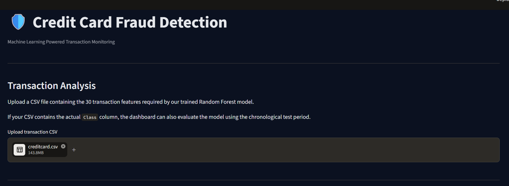
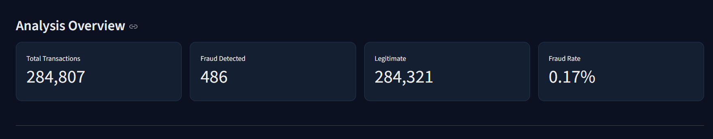
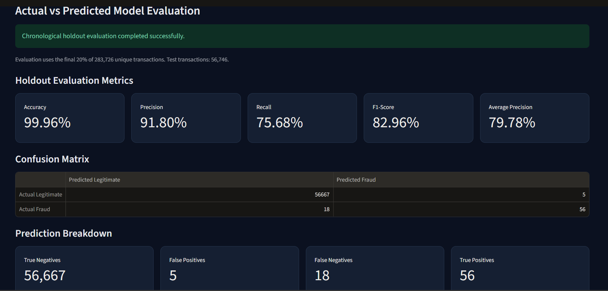
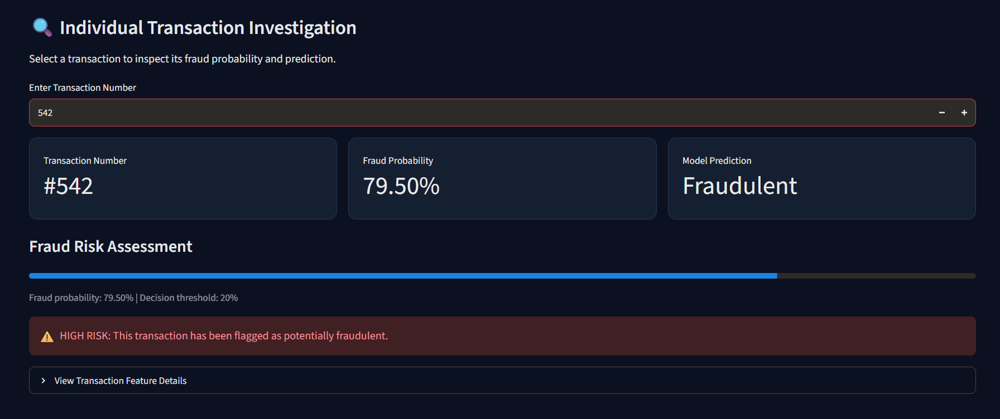
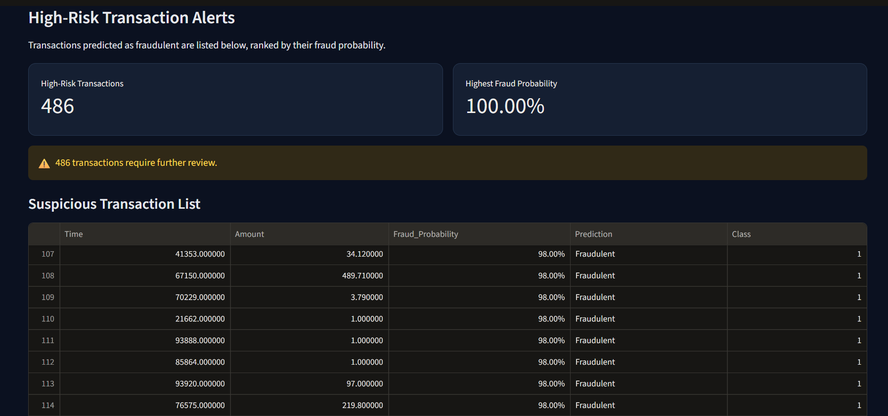

# 💳 Credit Card Fraud Detection Using Machine Learning

An end-to-end machine learning project that identifies potentially fraudulent credit card transactions using classification and anomaly detection techniques. The project includes exploratory data analysis, model comparison, chronological evaluation, and an interactive Streamlit dashboard for transaction investigation and fraud prediction.

## 📌 Project Overview

Credit card fraud is a major challenge in digital payments. Fraudulent transactions make up a very small proportion of all transactions, making fraud detection a highly imbalanced classification problem.

This project explores multiple machine learning algorithms and develops a Random Forest model to identify potentially fraudulent transactions. The final model is integrated into an interactive dashboard for transaction analysis and prediction.

## 🎯 Project Objectives

- Explore and understand credit card transaction data.
- Identify patterns and characteristics associated with fraudulent transactions.
- Handle severe class imbalance.
- Train and compare multiple machine learning models.
- Evaluate models using precision, recall, F1-score, and Average Precision.
- Use chronological validation and testing to simulate predictions on future transactions.
- Build an interactive dashboard for fraud detection and transaction investigation.

## 📊 Dataset

**Dataset:** European Credit Card Fraud Detection  
**Source:** [Kaggle – Credit Card Fraud Detection](https://www.kaggle.com/datasets/mlg-ulb/creditcardfraud)

The original dataset contains:

- Total transactions: 284,807
- Input features: 30
- Target variable: `Class`
- `0` = Legitimate transaction
- `1` = Fraudulent transaction

The features include:
- `Time`: Seconds elapsed between each transaction and the first transaction.
- `Amount`: Transaction amount.
- `V1`–`V28`: Anonymized features obtained through Principal Component Analysis (PCA).

The dataset contains historical transactions from September 2013.

During data preprocessing, 1,081 duplicate rows were removed, leaving **283,726 unique transactions** for model development and evaluation.

The dataset is highly imbalanced, with fraudulent transactions representing approximately 0.17% of the original records.

**Note:** The original dataset is not included in this repository because of its large file size. See the installation instructions below to download it.

## 🛠️ Technologies Used

- Python
- Pandas
- NumPy
- Matplotlib
- Seaborn
- Scikit-learn
- Streamlit
- Joblib
- Jupyter Notebook

## 🤖 Machine Learning Models

Three machine learning algorithms were implemented and compared:

1. **Logistic Regression** – A supervised classification algorithm used as a baseline model.
2. **Random Forest Classifier** – An ensemble learning algorithm that combines multiple decision trees for classification.
3. **Isolation Forest** – An unsupervised anomaly detection algorithm designed to identify unusual transactions.

Random Forest achieved the strongest overall performance in the experiments and was selected for the final dashboard.

## 📈 Final Model Performance

The final Random Forest model was evaluated using a chronological train-validation-test approach. Earlier transactions were used for training and validation, while the final 20% of transactions were reserved for testing.

**Selected decision threshold: 0.20 (20%)**

| Evaluation Metric | Result |
|---|---:|
| Accuracy | 99.96% |
| Precision | 91.80% |
| Recall | 75.68% |
| F1-Score | 82.96% |
| Average Precision | 79.78% |

### Confusion Matrix

| | Predicted Legitimate | Predicted Fraud |
|---|---:|---:|
| Actual Legitimate | 56,667 | 5 |
| Actual Fraud | 18 | 56 |

### Results Interpretation

On the chronological test set:

- **56** fraudulent transactions were correctly detected.
- **18** fraudulent transactions were missed.
- **5** legitimate transactions were incorrectly flagged as fraudulent.
- **56,667** legitimate transactions were correctly classified.

Precision indicates how many flagged transactions were actually fraudulent, while recall indicates how many actual fraud cases were detected.

These metrics are particularly important because the dataset contains very few fraudulent transactions compared with legitimate ones.

## 🖥️ Interactive Streamlit Dashboard

The project includes an interactive dashboard built using Streamlit.

### Dashboard Features

- **Analysis Overview:** Displays transaction statistics, predicted fraud counts, legitimate transactions, and fraud rate.
- **Model Evaluation:** Shows model performance metrics and the confusion matrix from chronological holdout testing.
- **Individual Transaction Investigation:** Allows users to inspect an individual transaction's predicted fraud probability and classification.
- **High-Risk Transaction Alerts:** Displays transactions flagged by the model, ranked by predicted fraud probability.
- **Prediction Results:** Provides transaction-level prediction results and a CSV download option.

## 📸 Dashboard Screenshots

### Dashboard Home


### Analysis Overview


### Model Evaluation


### Individual Transaction Investigation


### High-Risk Transaction Alerts


## 📁 Project Structure

```text
Credit-Card-Fraud-Detection/
│
├── data/
│   └── creditcard.csv
│
├── notebooks/
│   └── fraud_detection.ipynb
│
├── models/
│   └── fraud_detection_model.joblib
│
├── screenshots/
│   ├── dashboard-home.png
│   ├── dashboard-overview.png
│   ├── high-risk-alerts.png
│   ├── model-evaluation.png
│   └── transaction-investigation.png
│
├── app.py
├── requirements.txt
├── .gitignore
└── README.md
```

## ⚙️ Installation and Setup

### 1. Clone the repository

```bash
git clone https://github.com/bilallukman/Credit-Card-Fraud-Detection.git
```

Navigate to the project folder:

```bash
cd Credit-Card-Fraud-Detection
```

### 2. Install dependencies

```bash
pip install -r requirements.txt
```

### 3. Download the dataset

Download `creditcard.csv` from the [Kaggle dataset](https://www.kaggle.com/datasets/mlg-ulb/creditcardfraud).

Place the downloaded file inside the `data/` folder:

```text
data/creditcard.csv
```

The dataset is required for uploading transactions to the dashboard. The trained model is already included in the repository.

### 4. Run the Streamlit application

```bash
streamlit run app.py
```

The dashboard will open in your browser at:

```text
http://localhost:8501
```

## ⚠️ Important Disclaimer

This project is developed for educational and portfolio purposes using a historical credit card transaction dataset from 2013.

The model's results should not be interpreted as proof of production-level fraud detection performance. Real-world deployment would require additional validation, updated transaction data, continuous monitoring, and further testing under changing fraud patterns.

## 👨‍💻 Author

**Bilal Lukman**

BCA Data Science Student | Aspiring Data Analyst

GitHub: [@bilallukman](https://github.com/bilallukman)

---

⭐ If you find this project interesting, feel free to explore the repository!
